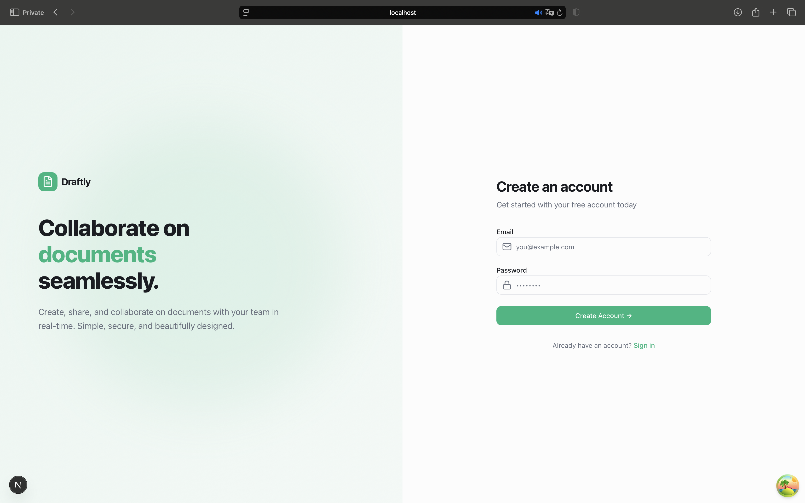
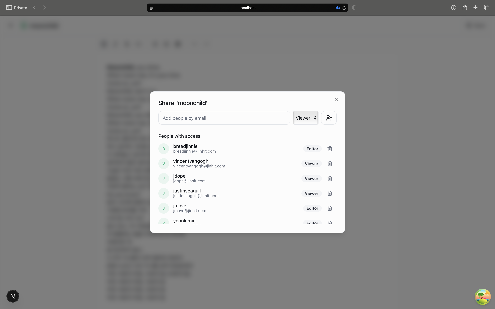
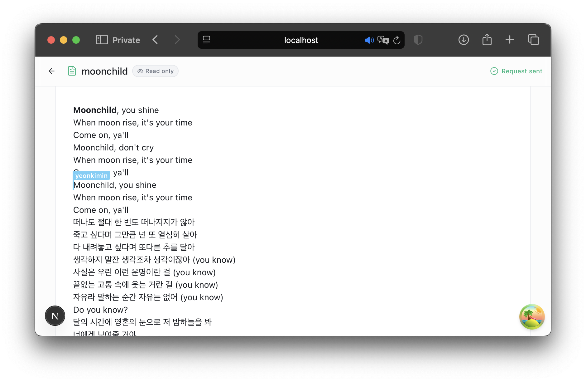
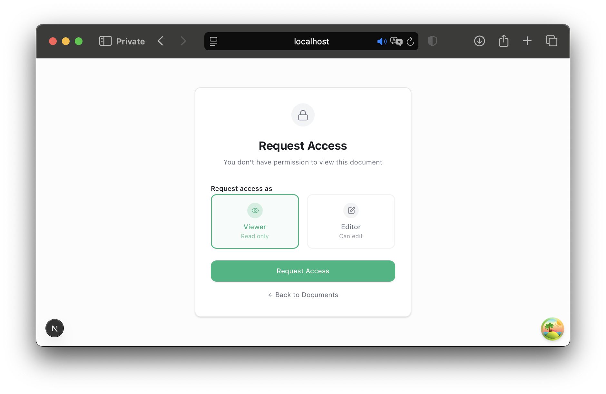
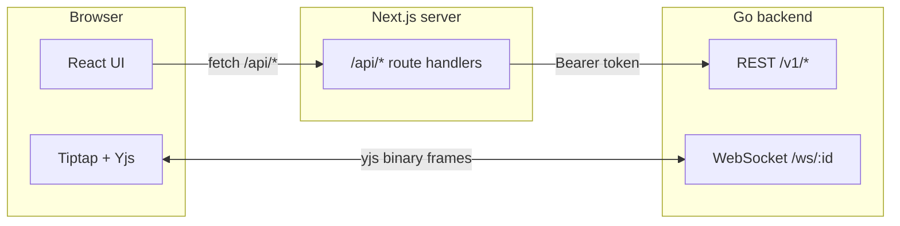

# Draftly Frontend

This is the frontend for Draftly, a small collaborative document editor.

Built with Next.js (App Router), React, and Tiptap. The live editing uses Yjs.

## What it is

Draftly lets people write documents together in real time.

The app has a few simple screens:

- Login / signup
- Your document list (docs you own and docs shared with you)
- The editor, where the writing happens
- Share and access request UI

The whole point is the editor: two people open the same doc and see each other type.

## Demo

<!-- > TODO: Live demo link -->

Here are screenshots of the flow.

**Login**


**Sign up**



**Document list** - your docs and the ones shared with you.


**Share dialog** - inviting a user as editor or viewer.



**Live editing** - two people in the same document.


**Live cursors** - each person gets a colored cursor with their name.


**Access requests** - asking for access, and the owner seeing requests.




**No access** - what you see when you open a doc without permission.



## Features

- Login and signup in one form.
- Document list split into "mine" and "shared with me".
- Editor built on Tiptap, with a toolbar for formatting.
- Live collaboration over WebSockets. No save button, everything syncs.
- Colored cursors with names, so you can see who is where.
- Roles: `owner` and `editor` can write, `viewer` is read only.
- Rename docs, share them, revoke access, request access.
- Thumbnails from a saved HTML snapshot.
- a mobile-friendly layout.
- Friendly error toasts for anything that fails.

## How it works

The frontend is a Next.js app. The browser talks to the backend two ways:

- **REST** for auth, documents, sharing. We call our own Next API routes under
  `/api/*`, and those routes proxy to the Go backend with the auth token.
- **WebSocket** for the live document. This connects straight to the backend.

Why the proxy? The auth token is stored in an HttpOnly cookie, so the browser
can't read it. The Next route handlers read the cookie on the server and add the
`Authorization` header for us.



### The editor

The editor is the interesting part.

- Tiptap handles the text and formatting. It's built on ProseMirror.
- Yjs is the source of truth. The real document is a Yjs CRDT, not HTML.
- Tiptap and Yjs are wired together so every keystroke becomes a small Yjs update.
- Those updates go over the WebSocket, so everyone in the room gets them and merges.
- Cursor position and color travel through Yjs "awareness", not the document itself.

On top of that, we save a plain HTML snapshot for thumbnails:

- The editor sends its HTML to `PATCH /api/documents/:id/autosave`, debounced.
- It only fires for `owner`/`editor`. Viewers never send it.
- On tab close we flush one last time with `keepalive: true`.
- It's one-directional: Yjs -> snapshot. We never load the doc from that HTML.

### State

- **TanStack Query** for server data (docs, auth, sharing). Errors show as toasts
  from one central place, with an option to skip a toast per query.
- **Zustand** for small UI state like the theme.

## Roles

| Action                | Owner | Editor | Viewer |
| --------------------- | :---: | :----: | :----: |
| Open the doc          |  yes  |  yes   |  yes   |
| Type / edit           |  yes  |  yes   |   no   |
| See other cursors     |  yes  |  yes   |  yes   |
| Rename                |  yes  |  yes   |   no   |
| Share / manage access |  yes  |   no   |   no   |
| Delete                |  yes  |   no   |   no   |

The editor switches to read only for `viewer`. The backend enforces this too, so
the UI rule is just for a nicer experience.

## Setup

### Prerequisites

- Node.js 20 or newer
- The backend running (see the backend README) on `http://localhost:8080`

### Install

```bash
git clone https://github.com/carr-o-t/draftly-frontend.git
cd frontend
npm install
cp .env.example .env   # then fill in the values
npm run dev
```

Open [http://localhost:3000](http://localhost:3000).

### Env vars

| Name                 | Required | Default                  | What it is                           |
| -------------------- | :------: | ------------------------ | ------------------------------------ |
| `NEXT_PUBLIC_WS_URL` |    no    | `ws://localhost:8080/ws` | WebSocket base url for live editing. |
| `NODE_ENV`           |    no    | `development`            | Standard node env.                   |

### Useful commands

```bash
npm run dev          # start the dev server
npm run build        # production build
npm run start        # run the production build
npm run lint         # eslint
npm run format       # prettier write
npm run format:check # prettier check
```

## Design decisions and tradeoffs

### Yjs instead of saving HTML

We could have sent the whole HTML on every change. That breaks with two editors:
they overwrite each other. Yjs merges edits from everyone with no conflicts, and
sends tiny updates instead of the whole doc. The cost: the server can't read the
content, it's opaque binary. That's why we also keep the HTML snapshot for
thumbnails.

### The API proxy

We route REST calls through Next route handlers instead of hitting the backend
directly. It's one extra hop, but it keeps the auth token in an HttpOnly cookie
(the browser can't see it, which is safer) and keeps the backend url off the
client.

### Read only is a UI hint

A viewer's editor is read only, but that's just the UI. The real check is on the
backend and on the socket. The client is never trusted.

## Where we got stuck

### The cursor extension crashed

We started with `@tiptap/extension-collaboration-cursor`, but it blew up with our
Tiptap v3 / y-tiptap versions. We dropped it and wrote a small custom extension
(`features/collaboration/collab-cursor.ts`) on top of `yCursorPlugin`. Works fine,
and we control the cursor markup.

### The WebSocket auth cookie

The auth cookie is HttpOnly, so Yjs couldn't read it to send on the socket. Fix:
the backend also sets a small non-HttpOnly `ws_token` cookie, and we pass it as
`?token=...` on the ws url. You need to log back in for this cookie to appear.

### StarterKit v3 options

In Tiptap v3, StarterKit changed some option names. The undo/redo one is `undoRedo`,
not `history`, and we had to turn it off because Yjs brings its own undo manager.

## Testing

There are no frontend unit tests yet. We rely on:

```bash
npm run lint
npm run format:check
npx tsc --noEmit
npm run build
```

These run in the pre-commit hook (via husky and lint-staged), so bad code doesn't
get committed.

## Deployment notes

- Set `NEXT_PUBLIC_WS_URL` to your backend's WebSocket url (use `wss://` in prod).
- The `/api/*` proxy targets `http://localhost:8080`. Point it at the real backend
  url for production.
- Deploys fine on Vercel, since the socket is handled by the backend, not Next.

## Known limitations

- The "shared with me" list always shows the role as viewer, we don't fetch the
  real role there yet.
- No offline editing. If the socket drops, edits pause until it reconnects.
- Cursor colors are random per session, so two people can get the same color.
- No presence list (who's in the doc right now).

## Roadmap

- Show the real role in the shared list.
- Better cursor colors (no collisions).
- Presence avatars in the editor header.
- Offline support with Yjs persistence.
- Frontend unit tests.
